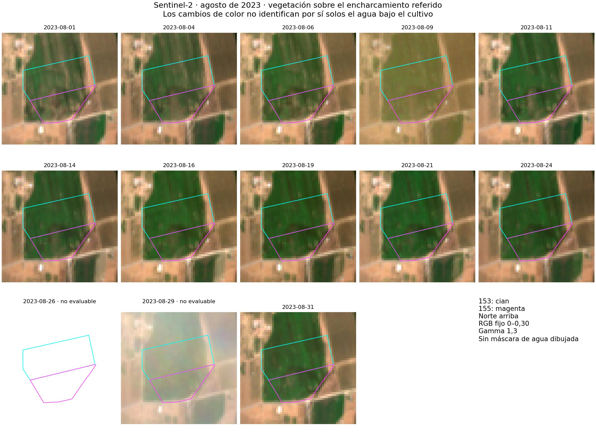
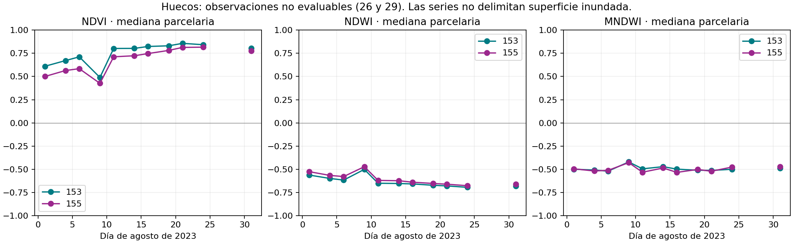

# Agua superficial por adquisición · método optical_surface_water_v2

Estado: exploratorio, sin calibración probabilística ni validación por píxel.
Las confirmaciones del usuario son presencia parcelaria, no contornos inundados.
El análisis del 16/08/2023 se añade como contraste independiente; varios episodios
durante agosto no implican agua visible en todas las pasadas.

## Política previa al cálculo

Los DN originales recortados se conservan con hashes. Se aplica una sola vez la
escala y el offset del asset, tras excluir nodata. Los valores BOA negativos se
conservan: no prueban por sí solos un error de conversión. Para interpretar un
cociente normalizado se exigen ambos operandos no negativos, finitos y suma
estrictamente mayor que 0,01. Es un suelo de señal conservador e inicial, no una
estimación del ruido instrumental. No se recorta a [-1,1] ni se rellena con cero.
NDVI, NDMI, NDWI y MNDWI siguen la misma política. EVI2 exige señal roja/NIR
interpretable; conserva valores válidos fuera de su escala visual 0–1.

Rejilla común EPSG:25830, origen y extensión alineados a 20 m; bandas nativas de
10 m en subceldas exactas. B03 se agrega por media de las cuatro subceldas a la
rejilla B11; un nodata invalida el bloque. MNDWI conserva observación de 20 m.
Para consultar ese soporte desde 10 m se replica el valor del padre, sin afirmar
detalle adicional. SCL se replica por vecino próximo, nunca por interpolación.

Regla inicial fijada antes del contraste completo:

* Calidad SCL 4/5/6; las demás clases no son evaluables.
* NDWI interpretable obligatorio para clasificar agua o seco. Un NDVI inválido
  no invalida por sí solo el NDWI. MNDWI faltante se registra por separado.
* Agua estimada: NIR <=0,15 y (SCL=6 o (NDWI>0 y MNDWI>0)).
  SCL=6 no es obligatorio y NDVI negativo tampoco. La coincidencia de índices
  pretende reducir confusiones con suelo oscuro y construcciones.
* Ambiguo: señal utilizable pero desacuerdo (NDWI>0, MNDWI>0 o SCL=6 sin cumplir
  agua), o señal oscura (NIR<0,06, SWIR<0,08 y NDVI interpretable <0,4).
  La segunda condición identifica una duda de interpretación, no agua confirmada.
* Resto: sin agua detectada. No equivale a ausencia de encharcamiento bajo cultivo.

Porcentaje principal = agua / área completa de la parcela maestra, por intersección
exacta de celdas. Cobertura clasificable = (agua + sin agua detectada) / área total.
Ambiguo y no evaluable se contabilizan aparte; ninguno se trata como seco. Menos
del 80% clasificable produce «No concluyente», conservando el agua observada.
Las transiciones sólo usan células clasificables en ambas fechas. Dos detecciones
no demuestran continuidad. La capa se refiere siempre a la fecha seleccionada.

## Referencias y límites

* [Procesamiento Sentinel-2, Copernicus](https://sentiwiki.copernicus.eu/web/s2-processing).
* [Yang et al. (2017), NDWI como guía de afinado](https://doi.org/10.3390/rs9060596).
  El experimento del repositorio se documenta con sus propias ecuaciones y no
  se presenta como reproducción exacta de este artículo.

Los índices ópticos describen respuesta espectral y posible extensión superficial;
no miden directamente profundidad o volumen. Una rejilla de 10 m no garantiza
detectar un charco de 100 m². Se informarán omisiones sin excepciones catastrales.

## Comprobación del 16/08/2023 y serie de agosto

El usuario precisa que había vegetación sobre el agua, en el sur de
`45137A03300153` y sobre todo en `45137A03300155`. Se conserva esa observación
como referencia de presencia y localización aproximada, sin inventar un contorno.
La serie contiene 13 adquisiciones de los días 1, 4, 6, 9, 11, 14, 16, 19, 21,
24, 26, 29 y 31. El 26 y 29 no son evaluables en estas parcelas por la máscara SCL.

En RGB con escala fija se aprecia una estructura irregular más clara en la 155,
también visible en varias fechas. El NDVI es menor allí que en la 153. La imagen
por sí sola no distingue entre agua bajo la cubierta, diferencias del cultivo,
suelo, manejo u otros factores. El 9 presenta además un aspecto velado general;
SCL lo admite, por lo que su caída de NDVI no puede atribuirse automáticamente a
un nuevo episodio de encharcamiento. La máscara no garantiza eliminar toda bruma.

| Parcela, 16/08 | Área del maestro | NDVI mediano | NDWI mediano | MNDWI mediano |
|---|---:|---:|---:|---:|
| 45137A03300153 | 52.915,239 m² | 0,824 | −0,658 | −0,499 |
| 45137A03300155 | 33.008,527 m² | 0,747 | −0,640 | −0,534 |

**SCL, NDWI>0 y la combinación no recuperan el agua comunicada en ninguna de las
11 observaciones utilizables.** Esto documenta una omisión del método para agua
cubierta por vegetación; no refuta la observación del usuario. No se calculan
hectáreas inundadas a partir de esa diferencia de color, ni se afirma parcela seca.
El afinado de B11 tampoco resuelve estos dos casos. Los contornos son los del
maestro recibido en 2026, aplicados como referencia espacial, no un levantamiento
catastral independiente de 2023.

[Detalle RGB del 16/08 con ambas parcelas](water-evidence/august-16-rgb.jpg).




## Radiometría del 14/10 y 31/10/2026

Se descargaron los NDVI publicados y se verificaron sus hashes contra el catálogo.
Recalculando la fórmula original en float32 sobre los DN JP2 de los mismos
productos, **la diferencia máxima en los píxeles publicados finitos es 0,0** en
ambas fechas. No se identifica un offset duplicado en ese flujo. Cada asset usa
su escala 0,0001 y offset −0,1 una sola vez; GDAL ReadAsArray devuelve DN.

| Parcela, 14/10 | Mínimo NDVI publicado | Máximo | Fuera de [-1,1] |
|---|---:|---:|---:|
| 45137A00900001 | −22,999603 | 7,200034 | 27 de 280 centros |
| 45137A00900059 | −3,857161 | 0,810714 | 11 de 421 centros |

En la 00001 hay 26 centros con rojo negativo y NIR positivo; en la 00059 hay
9 con NIR negativo. Son salidas BOA conservadas por el producto; la mezcla de
signos y las sumas pequeñas explican cocientes inestables. Esto no identifica
por sí solo la causa física del resultado atmosférico. El control de nodata
precede a la conversión, se verifican todas las rejillas y el cociente no se recorta.

Antes, el GeoTIFF conservaba los extremos, las medias parcelarias excluían valores
fuera de rango y el PNG los saturaba al color extremo. Ahora cálculo, estadísticas
y visualización comparten la política: no interpretable es nodata/transparente,
nunca −1 ni cero. WATER_QUALITY y el manifiesto registran los motivos y los DN
originales permanecen disponibles para investigar una política menos conservadora.
El 31/10 el mínimo NDVI de la 00001 es 0,0983729, también reproducido.

## Comparación de superficies

Intersecciones exactas de celdas con geometría maestra EPSG:25830, redondeadas a
0,001 m². «NDWI» es la alternativa NDWI>0 con control radiométrico; no una verdad
espacial. «Combinación» es el método propuesto. Ambigüedad no se suma al agua.

| Fecha | Parcela | SCL actual | NDWI 10 m | Combinación | Ambigua | No evaluable |
|---|---|---:|---:|---:|---:|---:|
| 14/10/2026 | 45137A00900059 | 2.662,448 | 2.895,093 | 1.000 | 3.095,093 | 3.125,918 |
| 31/10/2026 | 45137A00900059 | 800 | 928,252 | 800 | 6.546,210 | 0 |
| 14/10/2026 | 45137A00900001 | 400 | 0 | 0 | 0 | 2.600 |
| 31/10/2026 | 45137A00900001 | 0 | 0 | 0 | 1.700 | 0 |

Se reproducen los cuatro valores SCL de referencia, sin diferencias de producto
ni geometría. **No se considera validado el detector:** no recupera la presencia
comunicada en la 00001. El 14/10 la política conservadora deja sin interpretar la
señal oscura; el 31/10 hay 1.700 m² ambiguos, no confirmados como agua. Relajar
umbrales para obtener una detección en esa referencia no sería una validación.

Cuatro controles espaciales de contexto RGB (suelo desnudo al este, cultivo al
norte, entorno de construcciones al noroeste y zona oscura al oeste) dan 0 m² de
agua en las siete alternativas examinadas el 16/08 y las dos fechas de octubre.
Son contrastes visuales, no etiquetas independientes por píxel. Las sombras SCL
se excluyen y se prueban expresamente en regresiones. No hay un inventario de
sombras o construcciones validado en campo que permita declarar una tasa de falsos
positivos; tampoco se calculan exactitud, precisión o sensibilidad por píxel.

La reducción de superficie SCL de la 00059 es compatible con el descenso
comunicado, pero no mide la profundidad ni el volumen. El periodo comunicado
empieza el 10/10; no se ha inventado una adquisición de ese día.

## Experimento de B11 en rejilla de 10 m

Se ajusta, por adquisición, B11_20 = intercepto + β·media(NDWI_10), y una segunda
variante añade γ·media(NDVI_10), mediante regresión ridge (penalización 1e−6, sin
penalizar intercepto). Se inyecta sólo el residuo del predictor dentro de cada
bloque 2×2 y se reduce uniformemente su amplitud si generara B11 negativo. Así
se conserva la media B11 original. Se usan los datos de detalle de cada fecha;
no se traslada el patrón del 14 al 31. La técnica está implementada y documentada
en `scripts/water_sharpening.py`; no se presenta como réplica exacta del artículo
de Yang et al. ni como detalle SWIR observado.

La coherencia al reagregar tiene error absoluto máximo <=5,3×10⁻⁸ de reflectancia
en los tres productos completos. Es una comprobación de conservación, no de
exactitud del detalle. Se comparan NDWI nativo, MNDWI de soporte original 20 m,
MNDWI con B03 nativo y B11 replicado por vecino próximo, y los dos MNDWI estimados.
La réplica del vecino es una referencia sencilla, no una observación SWIR de 10 m.

| Fecha | Parcela | MNDWI 20 m >0 | Vecino próximo >0 | Guía NDWI >0 | Guías NDWI+NDVI >0 |
|---|---|---:|---:|---:|---:|
| 14/10/2026 | 45137A00900059 | 0 | 0 | 900 | 700 |
| 31/10/2026 | 45137A00900059 | 0 | 0 | 1.440,901 | 1.566,318 |
| 14/10/2026 | 45137A00900001 | 0 | 0 | 0 | 0 |
| 31/10/2026 | 45137A00900001 | 0 | 0 | 100 | 700 |

Superficies en m², con calidad radiométrica; son señales candidatas, no medidas
confirmadas de inundación. El cambio grande entre guías y la falta de contornos
independientes impiden decidir que esos píxeles sean agua real. Ambas referencias
simples y ambas guías dan 0 en las parcelas 153 y 155 el 16/08.
**El experimento no se incorpora al método operativo.**

## Reproducción y trazabilidad

Productos exactos de octubre:

* `S2A_MSIL2A_20261014T110941_N0513_R137_T30TUK_20261014T173008`
* `S2A_MSIL2A_20261031T110121_N0513_R094_T30TUK_20261031T173605`

Para agosto se analizan JP2 originales de baseline 05.09 distribuidos por el
espejo público AWS. El catálogo CDSE actual ofrece reprocesados 05.10; no se
presentan como el mismo producto. El 16/08 se usa
`S2A_MSIL2A_20230816T105631_N0509_R094_T30TUK_20230816T171602`.
El instante de tesela publicado por Earth Search puede diferir del inicio del
producto, pero no de la fecha: ambos se conservan en los metadatos. No se usan
los COG armonizados para aplicar de nuevo el offset. `tileinfo` debe confirmar
el nombre SAFE antes de leer cada JP2.

`water-evidence/` conserva catálogos de entrada, resultados, controles, hashes de
DN/productos, parámetros y diagnóstico publicado. Los rásteres originales y los
reprocesados permanecen en `artifacts/water-review/` (fuera de Git). El primer
recorte completo a 10 m se extendió a la rejilla de 20 m con nodata en un margen
externo al AOI solicitado; esto queda registrado, sin inventar cobertura.

Con Python GDAL/NumPy (matplotlib sólo para las figuras), desde la raíz:

```sh
python scripts/download_water_reference.py docs/water-evidence/august-catalogue.json artifacts/reproduce/august --refs 45137A03300153 45137A03300155
python scripts/water_reference_study.py artifacts/reproduce/august artifacts/reproduce/august-products --refs 45137A03300153 45137A03300155 --report artifacts/reproduce/august-results.json
python scripts/plot_water_reference.py artifacts/reproduce/august artifacts/reproduce/august-results.json artifacts/reproduce/figures
python scripts/download_water_reference.py docs/water-evidence/october-catalogue.json artifacts/reproduce/october --cdse-catalogue docs/water-evidence/october-cdse.json
python scripts/water_reference_study.py artifacts/reproduce/october artifacts/reproduce/october-products --refs 45137A00900001 45137A00900059 --report artifacts/reproduce/october-results.json
python scripts/water_reference_study.py artifacts/reproduce/october artifacts/reproduce/control-products --controls docs/water-evidence/controls.json --report artifacts/reproduce/controls.json
python scripts/build_sentinel_web.py artifacts/reproduce/october-products artifacts/reproduce/web/sentinel --collection
```

Para diagnosticar los GeoTIFF de la publicación antigua, usar
`scripts/diagnose_water_radiometry.py` con su catálogo congelado. El script exige
los hashes originales y se detiene si la publicación ha cambiado. Para rásteres
nuevos de extensión 20 m frente a los originales 10 m hay que recortar al mismo
extent antes del cotejo; el diagnóstico ejecutado usó directamente rejillas
idénticas. Las versiones de GDAL pueden cambiar los bytes comprimidos: comprobar
además identidad de producto, rejilla y valores, sin confundir hashes nuevos con
los originales conservados.

## Verificaciones realizadas y pendientes

* Reprocesamiento real de los dos productos exactos de octubre, con B03 original.
* Trece adquisiciones de agosto: índices, calidad y RGB; dos fechas no evaluables.
* Intersecciones SCL de referencia reproducidas y diagnóstico radiométrico exacto.
* Construcción real de catálogo v2 con 919 parcelas y tres fechas; la fecha más
  reciente se abre primero y el 16/08 dispone de estado sin referencia anterior.
* 53 pruebas Python con GDAL y nueve scripts de regresión de interfaz superados;
  gate del repositorio y política de localización verificados. Resultados CI en la PR.
* Navegador Chromium integrado: selección histórica, NDWI, comparador MNDWI,
  ficha, leyenda y colores; tamaños de escritorio, 390×844 y 320×568. Sin errores
  JavaScript observados. En esta revisión apareció un fragmento GEOS de área
  redondeada a cero; se corrigió la coherencia entre tabla y zonas y se añadió
  regresión antes de repetir la carga histórica, que pasó.
* No probado en teléfono físico. No desplegado en Pages ni fusionado en main.
* Pendiente una validación agronómica con contornos independientes, controles
  secos/sombras identificados y, para agua bajo cultivo, otras evidencias (por
  ejemplo radar o inspección de campo). No hay validación completa del detector.
